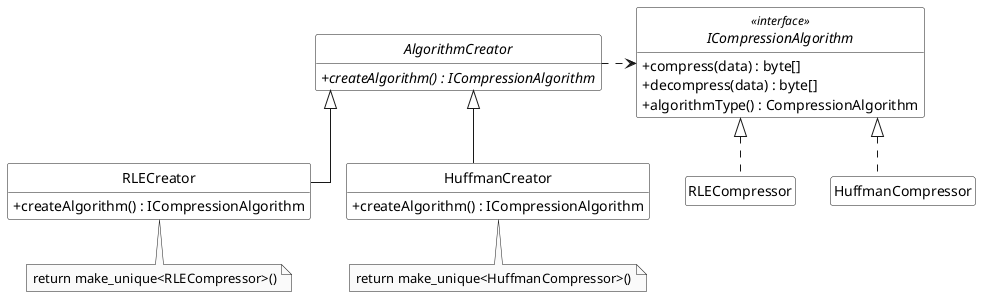
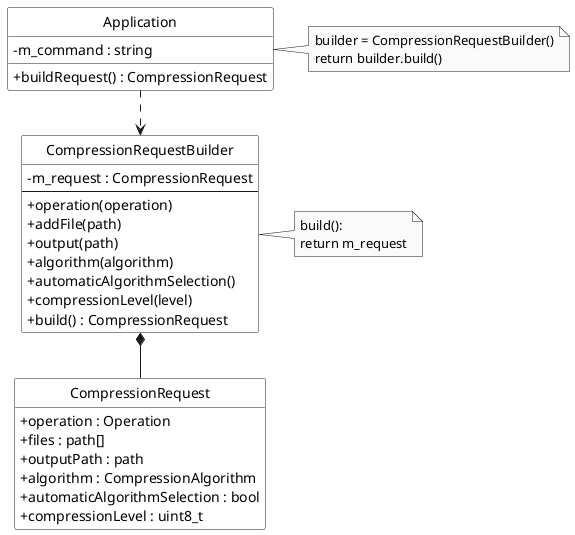
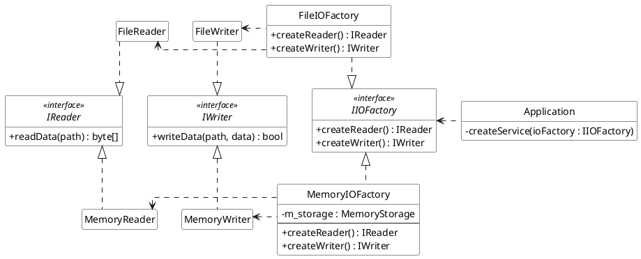

# Compressir

Compressir is a C++23 learning project for practicing design principles and design patterns. Its intended purpose is to compress several files into one archive and restore them later. Each file can use a different compression algorithm, with the chosen algorithm stored in its archive entry so extraction can create the correct decoder.

The project currently demonstrates the workflow and object construction. RLE, Huffman, file reading/writing, archive serialization, command parsing, and validation are still placeholders. It does not yet produce working compressed archives. Compression levels are stored in requests but are not applied yet.

Build and run:

```sh
cmake -S . -B build
cmake --build build
./build/main
```

The three sections below form the pattern report. All diagrams use PlantUML and can be pasted into a PlantUML editor. Class diagrams show the relevant pattern participants only; method signatures are abbreviated, and C++ ownership wrappers and reference qualifiers are omitted for readability. Hollow triangles denote inheritance or interface realization, dashed arrows denote dependencies, and filled diamonds denote composition.

## 1. Creational patterns

### Factory Method: compression algorithms

`AlgorithmCreator` declares the virtual factory method `createAlgorithm()`. `RLECreator` and `HuffmanCreator` override it to construct their corresponding implementations of `ICompressionAlgorithm`.

The small `createAlgorithmCreator(algorithm)` function routes an algorithm identifier to a creator. This routing function is a Simple Factory; the overridden `createAlgorithm()` methods demonstrate Factory Method. The distinction matters: moving a switch into a separate function alone would not demonstrate Factory Method.

`CompressionService` no longer owns one fixed compressor. For each input file it reads the data, chooses an algorithm, obtains its creator, and creates a compressor. The resulting `ArchiveEntry` stores the actual algorithm used. During extraction, the service creates a decoder using `entry.algorithm`, without repeating the selection heuristic.

Automatic selection is deliberately basic: empty data uses RLE; otherwise RLE is selected when more than half the bytes repeat their predecessor, and Huffman is selected for the remaining cases. This is a learning heuristic, not a guarantee of the smallest result. It is separate from compressor creation and can be replaced later.



### Builder: compression requests

`CompressionRequestBuilder` assembles a `CompressionRequest` step by step. It supports operation, input files, output destination, algorithm selection mode, and compression level. `build()` returns a value copy, so subsequent builder changes do not change an already built request. This implementation uses one concrete builder, with no Director or builder interface.

Automatic algorithm selection is enabled by default. Calling `algorithm(...)` forces that algorithm for every input file; calling `automaticAlgorithmSelection()` enables selection per file again. These settings affect compression; extraction always uses archive entry metadata.

For example:

```cpp
auto request = CompressionRequestBuilder{}
    .operation(Operation::Compress)
    .addFile("notes.txt")
    .addFile("image.bmp")
    .output("packed.myzip")
    .automaticAlgorithmSelection()
    .build();
```

`Application::buildRequest()` currently uses the builder to return the default placeholder request. Parsing and validation remain TODOs, so the builder currently handles assembly only. Those responsibilities can be connected later without changing the compression workflow.



### Abstract Factory: I/O families

`IIOFactory` declares `createReader()` and `createWriter()`. `FileIOFactory` produces `FileReader` and `FileWriter`; `MemoryIOFactory` produces `MemoryReader` and `MemoryWriter`.

The memory reader and writer share a path-to-bytes map belonging to their factory. This makes them a related product family: a writer's output is available to readers created by the same factory. Separate memory factories start with separate stores. Products retain shared ownership of their store and can outlive their factory.

`Application::createService()` accepts `IIOFactory` and uses it to create the service's reader and writer. The application currently chooses the file family. The memory family provides a small alternative for experiments without implementing the existing file I/O TODOs.

The diagram places file products above their interfaces and memory products below them. The factories occupy the middle column, with `Application` as the client on the right.



These changes apply a few design principles without adding more pattern layers:

- **KISS:** one small selection function, two concrete creators, one request builder, and two I/O families. No plugin registry or configuration framework.
- **Single Responsibility:** the service coordinates the workflow; creators construct compressors; the builder assembles requests; I/O factories construct related readers and writers.
- **Dependency Inversion:** the service uses reader, writer, and algorithm interfaces, while service assembly uses the I/O factory interface. This is partial: `Archiver` remains concrete and the service still calls the creator routing function.
- **Open/Closed:** algorithm implementations and I/O families can be added through their interfaces. Adding an algorithm still requires updating the enum and routing function, and potentially selection logic; full extensibility is intentionally deferred.

## 2. Structural patterns


## 3. Behavioral patterns
