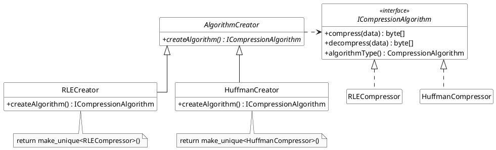
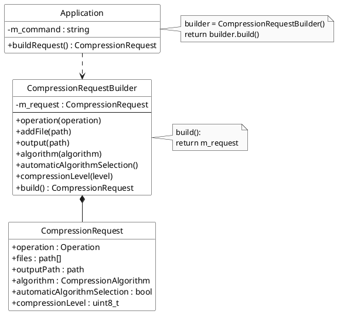
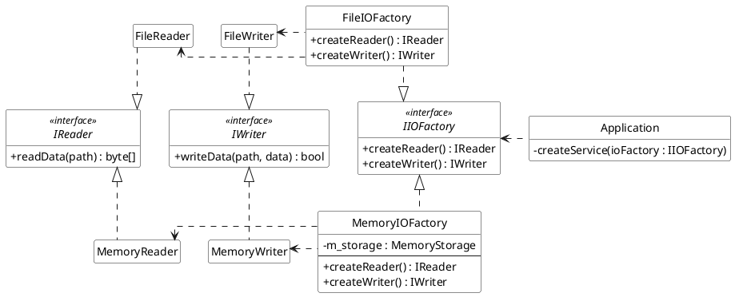
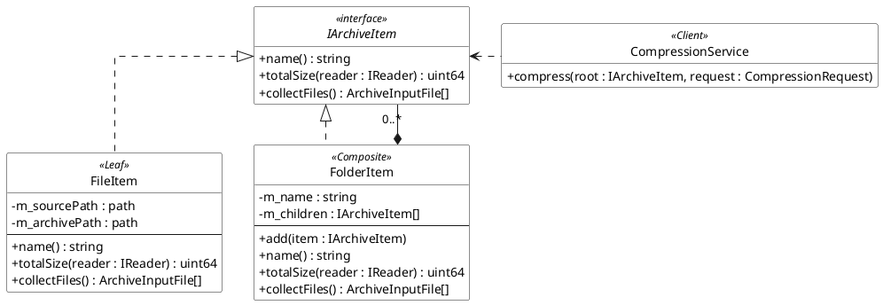
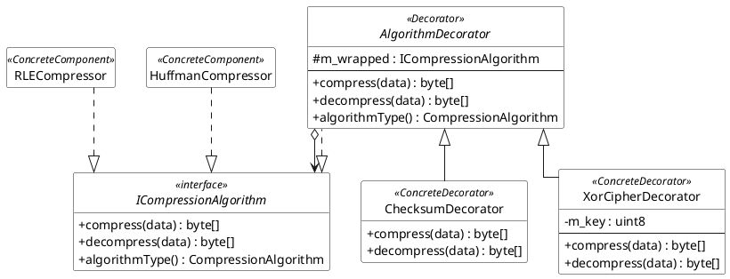
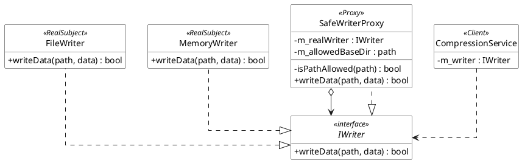

# Compressir

Compressir is a C++23 learning project for practicing design principles and design patterns. Its intended purpose is to compress several files into one archive and restore them later. Each file can use a different compression algorithm, with the chosen algorithm stored in its archive entry so extraction can create the correct decoder.

The project implements RLE and Huffman compression, binary file I/O, `.cmpr` archive packing/unpacking, CLI request parsing, and three structural patterns (Composite, Decorator, and Proxy) wired onto the Lab 1 creational patterns. Compression levels are stored in requests for future multi-level tuning.

Build, run, and test:

```sh
cmake -S . -B build
cmake --build build
ctest --test-dir build --output-on-failure
./build/main
```

CLI usage:

```sh
./build/main compress <files_or_folders...> -o <archive.cmpr> [--algo auto|rle|huffman] [--checksum] [--encrypt]
./build/main decompress <archive.cmpr> -o <output_dir>
```

The three sections below form the pattern report. All diagrams use PlantUML and can be pasted into a PlantUML editor. Class diagrams show the relevant pattern participants only; method signatures are abbreviated, and C++ ownership wrappers and reference qualifiers are omitted for readability. Hollow triangles denote inheritance or interface realization, dashed arrows denote dependencies, and filled diamonds denote composition.

## 1. Creational patterns

### Factory Method: compression algorithms

`AlgorithmCreator` declares the virtual factory method `createAlgorithm()`. `RLECreator` and `HuffmanCreator` override it to construct their corresponding implementations of `ICompressionAlgorithm`.

The small `createAlgorithmCreator(algorithm)` function routes an algorithm identifier to a creator. This routing function is a Simple Factory; the overridden `createAlgorithm()` methods demonstrate Factory Method. The distinction matters: moving a switch into a separate function alone would not demonstrate Factory Method.

`CompressionService` no longer owns one fixed compressor. For each input file it reads the data, chooses an algorithm, obtains its creator, and creates a compressor. The resulting `ArchiveEntry` stores the actual algorithm used. During extraction, the service creates a decoder using `entry.algorithm`, without repeating the selection heuristic.

Automatic selection is deliberately basic: empty data uses RLE; otherwise RLE is selected when more than half the bytes repeat their predecessor, and Huffman is selected for the remaining cases. This is a learning heuristic, not a guarantee of the smallest result. It is separate from compressor creation and can be replaced later.



### Builder: compression requests

`CompressionRequestBuilder` assembles a `CompressionRequest` step by step. It supports operation, input files, output destination, algorithm selection mode, and compression level. `build()` returns a value copy, so subsequent builder changes do not change an already built request. This implementation uses one concrete builder, with no Director or builder interface.

Automatic algorithm selection is enabled by default. Calling `algorithm(...)` forces that algorithm for every input file; calling `automaticAlgorithmSelection()` enables selection per file again. These settings affect compression; extraction always uses archive entry metadata.

For example:

```cpp
auto request = CompressionRequestBuilder{}
    .operation(Operation::Compress)
    .addFile("notes.txt")
    .addFile("image.bmp")
    .output("packed.myzip")
    .automaticAlgorithmSelection()
    .build();
```

`Application::buildRequest()` currently uses the builder to return the default placeholder request. Parsing and validation remain TODOs, so the builder currently handles assembly only. Those responsibilities can be connected later without changing the compression workflow.



### Abstract Factory: I/O families

`IIOFactory` declares `createReader()` and `createWriter()`. `FileIOFactory` produces `FileReader` and `FileWriter`; `MemoryIOFactory` produces `MemoryReader` and `MemoryWriter`.

The memory reader and writer share a path-to-bytes map belonging to their factory. This makes them a related product family: a writer's output is available to readers created by the same factory. Separate memory factories start with separate stores. Products retain shared ownership of their store and can outlive their factory.

`Application::createService()` accepts `IIOFactory` and uses it to create the service's reader and writer. The application currently chooses the file family. The memory family provides a small alternative for experiments without implementing the existing file I/O TODOs.

The diagram places file products above their interfaces and memory products below them. The factories occupy the middle column, with `Application` as the client on the right.



These changes apply a few design principles without adding more pattern layers:

- **KISS:** one small selection function, two concrete creators, one request builder, and two I/O families. No plugin registry or configuration framework.
- **Single Responsibility:** the service coordinates the workflow; creators construct compressors; the builder assembles requests; I/O factories construct related readers and writers.
- **Dependency Inversion:** the service uses reader, writer, and algorithm interfaces, while service assembly uses the I/O factory interface. This is partial: `Archiver` remains concrete and the service still calls the creator routing function.
- **Open/Closed:** algorithm implementations and I/O families can be added through their interfaces. Adding an algorithm still requires updating the enum and routing function, and potentially selection logic; full extensibility is intentionally deferred.

## 2. Structural patterns

### Composite: uniform files and nested folders

`IArchiveItem` declares the shared component interface (`name()`, `totalSize(reader)`, and `collectFiles()`). `FileItem` is the leaf representing a single input file, while `FolderItem` is the composite holding zero or more `IArchiveItem` children (`FileItem` or nested `FolderItem` instances).

When `collectFiles()` is called on a `FolderItem`, it recursively collects files from every child and prefixes its folder name onto each child's relative `archivePath`. `CompressionService::compress(root, request)` works purely through `IArchiveItem`, so compressing one file or an entire nested folder tree uses the exact same code path with no type checks or `dynamic_cast`.



Key implementation in [src/patterns/FolderItem.cpp](src/patterns/FolderItem.cpp):

```cpp
std::vector<ArchiveInputFile> FolderItem::collectFiles() const {
    std::vector<ArchiveInputFile> collected;
    for (const auto& child : m_children) {
        auto childFiles = child->collectFiles();
        for (auto& file : childFiles) {
            if (!m_name.empty()) {
                file.archivePath = std::filesystem::path{m_name} / file.archivePath;
            }
            collected.push_back(std::move(file));
        }
    }
    return collected;
}
```

`FolderItem::collectFiles()` delegates to each `IArchiveItem` child uniformly and builds the archive-relative hierarchy on the way back up.

### Decorator: runtime compression pipeline stages

`AlgorithmDecorator` implements `ICompressionAlgorithm` and wraps another `ICompressionAlgorithm` created by Lab 1's `AlgorithmCreator`. `ChecksumDecorator` appends a 4-byte FNV-1a checksum on `compress()` and verifies/strips it before delegating on `decompress()`. `XorCipherDecorator` XOR-masks compressed bytes with a key on `compress()` and unmasks them before delegating on `decompress()`.

Because every decorator exposes the same `ICompressionAlgorithm` interface as `RLECompressor` and `HuffmanCompressor`, decorators can be stacked at runtime in any order (`Checksum(Xor(base))` or `Xor(Checksum(base))`) without changing the concrete compressors. `ArchiveEntry` records `hasChecksum` and `isEncrypted` so decompression reconstructs the matching wrapper chain automatically.



Key implementation in [src/patterns/ChecksumDecorator.cpp](src/patterns/ChecksumDecorator.cpp):

```cpp
std::vector<std::byte> ChecksumDecorator::decompress(const std::vector<std::byte>& data) {
    if (data.size() < 4) {
        throw std::runtime_error("Corrupted data: missing checksum trailer");
    }
    const std::size_t payloadSize = data.size() - 4;
    std::uint32_t expected = 0;
    for (unsigned i = 0; i < 4; ++i) {
        expected |= static_cast<std::uint32_t>(
                        std::to_integer<std::uint8_t>(data[payloadSize + i]))
                    << (i * 8u);
    }
    if (fnv1a32(data, payloadSize) != expected) {
        throw std::runtime_error("Checksum verification failed: compressed data is corrupted");
    }
    std::vector<std::byte> payload(
        data.begin(), data.begin() + static_cast<std::ptrdiff_t>(payloadSize)
    );
    return m_wrapped->decompress(payload);
}
```

The decorator validates integrity before delegating decompression to `m_wrapped`, allowing arbitrary wrapping of any `ICompressionAlgorithm`.

### Proxy: path-guarded archive writing

`SafeWriterProxy` implements `IWriter` and wraps any real `IWriter` (`FileWriter` or `MemoryWriter` produced by Lab 1's `IIOFactory`). Before forwarding `writeData(path, data)`, it normalizes both `path` and `m_allowedBaseDir` lexically to ensure the target lies strictly inside the allowed directory.

This blocks Zip-Slip path traversal attempts (such as `../../evil.txt`, absolute outside paths, or sibling-prefix paths) without touching the real writer, while passing authorized writes through unchanged. `CompressionService` depends only on `IWriter` and does not need to know whether a proxy is guarding the writer.



Key implementation in [src/patterns/SafeWriterProxy.cpp](src/patterns/SafeWriterProxy.cpp):

```cpp
bool SafeWriterProxy::writeData(const std::filesystem::path& path,
                                const std::vector<std::byte>& data) {
    if (!isPathAllowed(path)) {
        std::cerr << "[SafeWriterProxy] Blocked write outside allowed directory '"
                  << m_allowedBaseDir.string() << "': " << path.string() << '\n';
        return false;
    }

    return m_realWriter->writeData(path, data);
}
```

`SafeWriterProxy` enforces the path boundary check first and only delegates to `m_realWriter` when the path resolves inside `m_allowedBaseDir`.

### Pattern interaction and verification

All three structural patterns cooperate inside a single `Application` / `CompressionService` run built on Lab 1's creational patterns:

1. `CompressionRequestBuilder` (Lab 1 Builder) assembles the `CompressionRequest`.
2. `IIOFactory` (Lab 1 Abstract Factory) creates `IReader` and `IWriter`, and `Application` wraps `IWriter` in `SafeWriterProxy` (**Proxy**).
3. `CompressionService` converts input paths into an `IArchiveItem` tree of `FileItem` and `FolderItem` nodes (**Composite**) and iterates `collectFiles()` uniformly.
4. For each file, `AlgorithmCreator` (Lab 1 Factory Method) constructs `RLECompressor` or `HuffmanCompressor`, which `CompressionService` wraps in `ChecksumDecorator` / `XorCipherDecorator` (**Decorator**).
5. `Archiver` packs/unpacks entries into `.cmpr` binary format, and `SafeWriterProxy` guards writing both the `.cmpr` archive and every extracted entry.

Unit tests in [tests/test_main.cpp](tests/test_main.cpp) verify each pattern's key property, RLE/Huffman compression, and end-to-end interaction:

- **Composite:** `composite_leaf_and_group_share_interface`, `composite_integrates_with_compression_service`
- **Decorator:** `decorator_stackable_in_any_order`, `decorator_checksum_detects_corruption`
- **Proxy:** `proxy_blocks_unauthorized_access`, `proxy_passes_authorized_calls_unchanged`
- **Algorithms & Integration:** `rle_round_trip_and_compression`, `huffman_round_trip_and_compression`, `end_to_end_patterns_interact_and_block_zip_slip`

```text
ctest --test-dir build --output-on-failure
1/1 Test #1: compressir_tests .................   Passed    0.00 sec
100% tests passed, 0 tests failed out of 1
```

Design notes and reflection:

- **KISS & Separation of Concerns:** RLE uses a small PackBits-style byte format and Huffman stores a compact sparse frequency table so real text and repetitive files shrink noticeably without complex streaming state machines.
- **Open/Closed & Dependency Inversion:** Adding a new `AlgorithmDecorator` subclass, a new `IArchiveItem` node, or another `IWriter` proxy requires no edits to existing compressors, `FileWriter`/`MemoryWriter`, or `CompressionService` compression loops.
- **What was trickier than expected:** Ensuring `SafeWriterProxy` handled relative paths, trailing slashes, and sibling prefix paths (`/tmp/out` vs `/tmp/out_evil`) cleanly using component-wise `lexically_relative` without requiring target files to already exist on disk (so it works identically with `MemoryWriter` in unit tests).
- **Future improvement:** Making `Archiver` an interface (`IArchiver`) and extracting algorithm selection into a Strategy object in Chapter 3 (Behavioral patterns) will make `CompressionService` completely independent of concrete selection heuristics and archive formats.

## 3. Behavioral patterns
